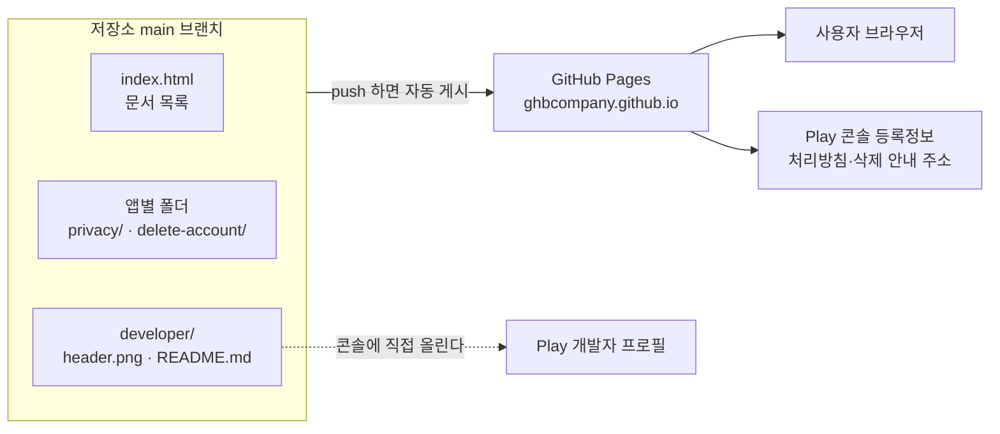
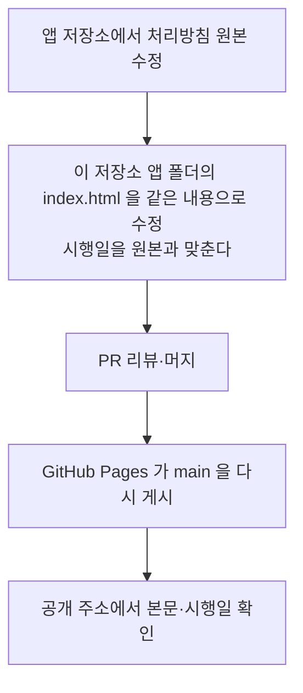

# ghbcompany.github.io

ghbcompany 가 Google Play 에 올리는 앱(스티커 메이커·터치패드·삐삐)의 공개 문서를 GitHub Pages 로 게시한다. 앱마다 경로를 나눠 개인정보 처리방침과 계정·데이터 삭제 안내를 두고, Play 콘솔 등록정보에는 이 주소를 넣는다. 루트 페이지는 문서 목록이고, Play 개발자 프로필에 쓰는 그림과 입력값도 이 저장소에 둔다.

## 먼저 읽을 문서

| 문서 | 내용 |
|---|---|
| [developer/README.md](developer/README.md) | Play 개발자 프로필 칸별 값, 헤더 이미지 규격과 다시 그리는 방법 |
| 각 앱 폴더의 `index.html` | 게시되는 문서 본문 그대로다. 문구는 이 파일에서 확인한다 |

## 기술 스택

| 계층 | 기술 | 버전 |
|---|---|---|
| 게시 | GitHub Pages(브랜치 게시, `main` 의 `/`) | - |
| 문서 | 정적 HTML(빌드 도구·스크립트·외부 리소스 없음) | - |
| 처리 | `.nojekyll` — Jekyll 변환 없이 파일을 그대로 낸다 | - |
| 그림 생성 | Python 3 + Pillow(`developer/make_header.py`) | - |
| 글꼴 | 나눔스퀘어라운드 B·R(헤더 이미지에만 쓴다) | - |

저장소에 고정한 버전이 없어 모두 `-` 로 둔다.

## 아키텍처



페이지는 서버 처리 없이 정적 파일로만 나간다. 화면에서 입력을 받거나 쿠키·분석 도구를 쓰지 않는다.

## 주요 처리 흐름



## 현재 제공 범위

| 경로 | 문서 | 공개 주소 |
|---|---|---|
| `/` | 문서 목록 | https://ghbcompany.github.io/ |
| `stickermaker/privacy/` | 스티커 메이커 개인정보 처리방침 | https://ghbcompany.github.io/stickermaker/privacy/ |
| `touchpad/privacy/` | 터치패드 개인정보 처리방침 | https://ghbcompany.github.io/touchpad/privacy/ |
| `beepbeep/privacy/` | 삐삐 개인정보 처리방침 | https://ghbcompany.github.io/beepbeep/privacy/ |
| `beepbeep/delete-account/` | 삐삐 계정·데이터 삭제 안내 | https://ghbcompany.github.io/beepbeep/delete-account/ |
| `developer/` | Play 개발자 프로필 자료(헤더 이미지·입력값) | 저장소에서만 본다 |

각 문서의 시행일은 본문 첫머리에 있다. README 에는 시행일을 옮겨 적지 않는다.

## 구성과 데이터 원칙

- 이 저장소는 공개 저장소다. 비밀·인증 키·계정 정보·내부 주소를 넣지 않는다.
- 처리방침의 원본은 각 앱 저장소에 있고, 이 저장소의 파일은 게시본이다. 원본을 고치면 같은 변경으로 게시본도 고치고 시행일을 맞춘다. 앱 저장소의 자동 시험은 이 게시본을 보지 못하므로 사람이 대조한다.
- Play 에 등록한 주소가 바뀌지 않도록 경로(`<앱>/privacy/` 등)는 옮기지 않는다. 앱을 더할 때는 새 폴더를 만들고 `index.html` 목록에 링크를 더한다.
- 헤더 이미지는 앱 아이콘과 글꼴로 수식처럼 그린다. 생성형 AI 는 쓰지 않는다.

## 로컬 실행

빌드 과정이 없다. 저장소 루트에서 정적 서버를 띄워 확인한다.

```bash
python3 -m http.server 8000
# http://localhost:8000/ 에서 목록과 각 문서를 연다
```

헤더 이미지를 다시 만드는 명령은 [developer/README.md](developer/README.md) 에 있다.

## 배포와 확인

### 게시

`main` 에 머지하면 GitHub Pages 가 자동으로 다시 게시한다. 별도 워크플로는 없다.

### 확인

- 저장소 › Actions 의 `pages build and deployment` 실행이 성공했는지 본다.
- 공개 주소를 열어 고친 문구와 시행일이 보이는지 확인한다. 브라우저 캐시 때문에 옛 본문이 보이면 새로 고침한다.

## 검증과 후속 관리

- 처리방침을 고친 PR 에는 원본과 게시본을 대조한 결과를 적는다.
- 링크를 더하거나 경로를 바꾸면 목록 페이지의 링크가 모두 열리는지 확인한다.
- 앱이 늘거나 아이콘이 바뀌면 헤더 이미지를 다시 만든다.

## 확인 필요

- Play 개발자 프로필 페이지(https://play.google.com/store/apps/dev?id=7769092577978646068)가 공개로 열리는지. 2026-11-27 오전에는 404 였다.

## 설계·과거 기록

변경 이력은 커밋 기록과 PR 에서 본다. 처리방침 문구의 근거와 이전 판은 각 앱 저장소의 원본 문서 이력에 있다.
